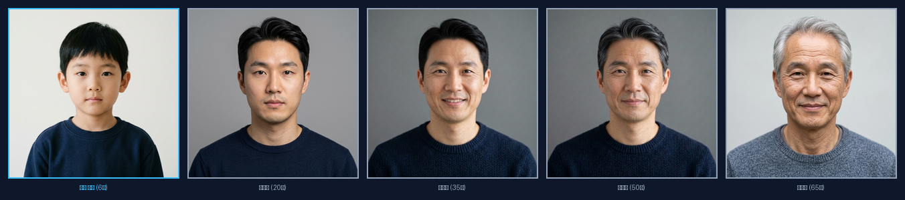

# Kinship-Guided Age Progression System for Long-Term Missing Children
> **장기 실종아동 나이 변환(Age Progression) 및 친부모 유전 정보(Kinship Cross-Attention) 기반 AI 시스템**

[](https://www.python.org/)
[](https://pytorch.org/)
[](https://fastapi.tiangolo.com/)
[](https://colab.research.google.com/github/ggg2214/kinship-age-progression/blob/main/notebooks/train_colab.ipynb)
[](https://opensource.org/licenses/MIT)

---

## 📌 개요 (Overview)

본 프로젝트는 장기 실종아동의 현재 모습을 예측하기 위해 **친부모 유전 정보(Kinship Guided Generation)**와 **생체 안면 정체성 보존(Identity Preservation)**을 결합한 딥러닝 기반 나이 변환(Age Progression) 시스템입니다.

유아기 사진만으로는 예측하기 어려운 성인기의 하관, 이목구비 골격 변화를 친부모 사진의 Cross-Attention 융합 벡터($V_{Kin}$)를 통해 보완하며, 부모 사진이 결측된 경우에도 자가 폴백(Self-Conditioning) 모드로 안정적으로 동작합니다.

---

## 🏗️ 시스템 아키텍처 (System Architecture)

```
[Child Face Image] -------> [ ArcFace Encoder ] ---------> V_C (512-d)
                                                                 │ (Query)
[Father Face Image] ------> [ ArcFace Encoder ] ──> V_F ──┐      │
                                                          ├──> [ Cross-Attention ] ──> V_Kin (512-d)
[Mother Face Image] ------> [ ArcFace Encoder ] ──> V_M ──┘      │ (Key/Val)           │
                                                                                       │
[Target Age / Delta] -----> [ Age Conditioner ] ─────────> V_Age (512-d) ──────────────┼──> [ Conditioning Fusion ]
                                                                                       │            │
                                                                                       │         W_cond
                                                                                       ▼            ▼
                                                                             [ AdaIN Generator ] ──> [ Aged Face Image ]
```

### 1. 핵심 모듈 구성
1. **ArcFace Encoder (`models/arcface_encoder.py`)**: 아동($V_C$) 및 친부모($V_F, V_M$)의 얼굴에서 고유 안면 골격을 보존하는 512차원 정규화 임베딩 추출.
2. **Kinship Cross-Attention Fusion (`models/kinship_fusion.py`)**: 아동 특징(Query)에 부모 특징(Key/Value)을 매핑하여 특정 부위(하관, 눈매 등) 가중치를 동적으로 결합한 $V_{Kin}$ 산출 (부모 결측 시 Fallback 지원).
3. **Age Conditioner & AdaIN Generator (`models/age_conditioner.py`, `models/generator.py`)**: 목표 나이 Fourier 임베딩과 AdaIN 잔차 블록을 결합하여 자연스러운 노화(주름, 피부 탄력 등) 합성.
4. **4단계 복합 손실 최적화 (`losses/total_loss.py`)**:
   $$ Loss_{Total} = \lambda_1 Loss_{Recon} + \lambda_2 Loss_{ID} + \lambda_3 Loss_{Age} + \lambda_4 Loss_{Kinship} $$

---

## 🖼️ 시각화 및 시연 (Visualizations)

### 1. 연령별 성장 파노라마 (Age Progression Timeline)
`outputs/sample_family_timelapse.png` 예시:


### 2. 대화형 Web UI (FastAPI Dashboard)
- 아동 및 부모 사진 드래그 앤 드롭 업로드 & 샘플 원클릭 채우기
- 실시간 타겟 나이 슬라이더 조절 (5세 ~ 75세)
- 안면 정체성 보존도 (ArcFace 코사인 유사도) & 친부/친모 유전 기여도 (%) 시각화 차트

---

## 🚀 빠른 시작 (Quick Start)

### 1. 설치 (Installation)
```bash
git clone https://github.com/ggg2214/kinship-age-progression.git
cd kinship-age-progression

pip install torch torchvision --index-url https://download.pytorch.org/whl/cpu
pip install fastapi uvicorn python-multipart Pillow
```

### 2. Google Colab 무료 T4 GPU 원클릭 학습 (Recommended)
[](https://colab.research.google.com/github/ggg2214/kinship-age-progression/blob/main/notebooks/train_colab.ipynb)
- 상단 뱃지를 클릭하여 Google Colab에서 256x256 해상도 대규모 모델 학습 및 Google Drive 가중치 백업을 바로 실행할 수 있습니다.

### 3. 실제 데이터셋 수집 및 파싱 파이프라인 (Real Datasets)
본 프로젝트는 **실제 안면 및 혈연 데이터셋**을 수집하고 학습하기 위한 전용 파이프라인을 내장하고 있습니다:

1. **FG-NET 종단면 실제 노화 데이터 (Longitudinal Face Aging)**:
   - 동일 인물의 유아기(0~12세)와 성인기(18~69세) 사진 1,002장, 1,195개 페어를 자동 다운로드 및 파싱
   ```bash
   python age_progression/data/download_fgnet.py
   ```

2. **AI Hub (aihub.or.kr) 한국인 안면 및 가족 데이터셋**:
   - 한국인 가족 안면 데이터(Kinship Guided), 한국인 연령대별 안면 데이터, K-Face 지원
   - `aihubshell` 다운로드 안내 및 자동 Triplet 파싱:
   ```bash
   python age_progression/data/aihub_parser.py --guide
   python age_progression/data/aihub_parser.py --source-dir "C:/path/to/aihub" --type family
   ```

3. **FIW (Families in the Wild) 대규모 혈연 데이터**:
   ```bash
   python age_progression/data/fiw_parser.py --fiw-dir "C:/path/to/fiw"
   ```

### 4. 3단계 점진적 커리큘럼 학습 (Curriculum Learning)
안정적이고 정밀한 노화 생성을 위해 3단계 커리큘럼 파이프라인을 지원합니다:
- **Phase 1 (기초 공사)**: 일반 안면 기반 신원 보존($L_{ID}$) 및 안면 재구성($L_{Recon}$) 사전 학습
- **Phase 2 (동양인/연령대 특화)**: 한국인/동양인 안면 및 연령대별 노화 곡선($L_{Age}$) 특화
- **Phase 3 (골격 노화 & 혈연 융합)**: FG-NET 종단면 실제 데이터 및 가족 혈연 데이터($L_{Kinship}$) 통합 학습

```bash
# 전체 3단계 커리큘럼 학습 실행
python age_progression/train_curriculum.py --phase all --epochs 1 --batch-size 4 --image-size 128
```

### 5. 저화질 아동 사진 복원 및 선명화 (Face Enhancement)
```bash
python age_progression/data/face_enhancer.py --input blurry_child.jpg --output enhanced_child.png
```

### 6. 대화형 웹 인터페이스 실행 (Web UI)
```bash
python age_progression/web_app.py
```
브라우저에서 `http://127.0.0.1:8000` 접속 (웹에서 AI 안면 복원 토글 지원)

### 7. 연령별 타임랩스 배너 생성 CLI
```bash
python age_progression/visualize_samples.py \
  --child sample_data/family_001/child_age06.jpg \
  --father sample_data/family_001/father_age38.jpg \
  --mother sample_data/family_001/mother_age35.jpg \
  --ages 10 20 30 40 50 60 \
  --output outputs/my_timelapse.png
```

### 8. 소거 연구(Ablation Study) 및 벤치마크 평가
```bash
# 실제 FG-NET 종단면 데이터 기반 정량 평가
python age_progression/evaluate.py --checkpoint checkpoints/age_progression_curriculum.pt --manifest data_fgnet/manifest_fgnet.json --num-samples 16
```

---

## 📁 프로젝트 구조 (Project Directory)

```
.
├── notebooks/
│   └── train_colab.ipynb         # [Colab] Google Colab 무료 T4 GPU 원클릭 학습 노트북
├── age_progression/
│   ├── config.py                 # 하이퍼파라미터 및 손실 가중치 설정
│   ├── demo.py                   # 모델 초기화, Forward, Multi-loss 통합 검증
│   ├── evaluate.py               # 정량 평가 및 소거 연구(Ablation) 벤치마크
│   ├── inference.py              # 나이 변환 엔드투엔드 추론 파이프라인 (복원 지원)
│   ├── train.py                  # 표준 모델 학습 루프
│   ├── train_curriculum.py       # 3단계 점진적 커리큘럼 학습 엔진
│   ├── visualize_samples.py      # 연령대별 연속 변환 그리드 생성 스크립트
│   ├── web_app.py                # FastAPI 웹 애플리케이션 및 REST API
│   ├── static/                   # 웹 대시보드 프론트엔드 (HTML/CSS, 복원 토글)
│   ├── data/
│   │   ├── dataset.py            # Triplet 데이터셋 로더 (커스텀 collator 내장)
│   │   ├── download_fgnet.py     # FG-NET 종단면 실제 데이터 다운로더 & 페어 빌더
│   │   ├── aihub_parser.py       # AI Hub 한국인 안면/가족 파서 & CLI 가이드
│   │   ├── fiw_parser.py         # Families in the Wild 혈연 데이터셋 파서
│   │   ├── face_enhancer.py      # 저화질/블러 아동 사진 복원 및 선명화기
│   │   ├── download_datasets.py  # UTKFace 다운로더 & 매핑기
│   │   └── transforms.py         # 얼굴 정렬 및 전처리 파이프라인
│   ├── losses/                   # 4단계 복합 손실 함수 (Recon, ID, Age, Kinship)
│   └── models/                   # ArcFace, Kinship Fusion, AdaIN Generator 모델
├── checkpoints/                  # 학습 가중치 저장 디렉토리 (Curriculum/Latest)
├── sample_data/                  # 검증용 합성 가족 Triplet 데이터
└── outputs/                      # 생성된 타임랩스 및 분석 결과 이미지
```

---

## 📄 라이선스 (License)
MIT License

